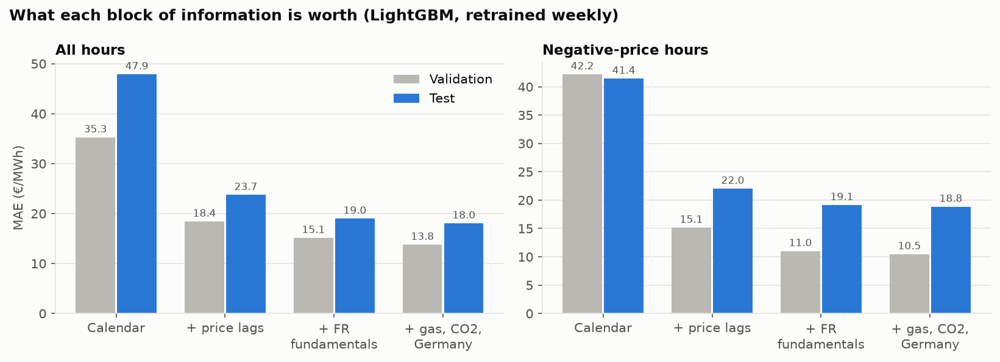
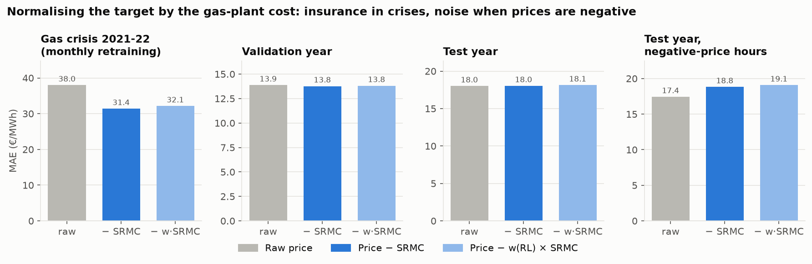
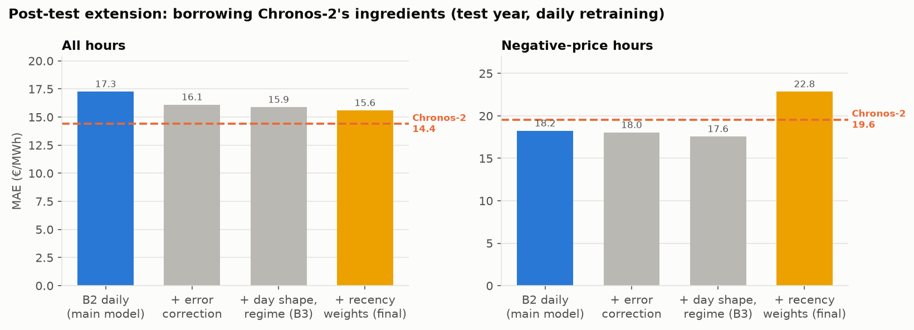

# French day-ahead power price forecasting

Every day before 12:00, traders submit their bids for the next day's 24 hourly electricity prices in
the European day-ahead auction. This project forecasts the French price of each of those hours using
only information published before the auction closes. It compares three kinds of model and measures
how much each data source improves the forecast:

- a gradient-boosting model (LightGBM), the main model;
- LEAR, the standard linear benchmark of the price-forecasting literature;
- Chronos-2, a model pre-trained on many time series and used here without any training on French
  prices.

---

## Main results

Test year: Nov. 2025 – Oct. 2026, kept aside until every modelling choice had been made on the
previous year. Error = mean absolute error (MAE) over the 8,760 hours of the year.

| Model | Data used | Test MAE (€/MWh) | Share of the naive error |
|---|---|---|---|
| Naive: same hour one week earlier | last week's price | 39.7 | 100 % |
| LEAR-B2 (linear) | full data set | 17.0 | 43 % |
| **LightGBM (main model)** | full data set | **17.3** | 44 % |
| LightGBM, final version | full data set + extra features | 15.6 | 39 % |
| Chronos-2 (pre-trained, no training) | full data set | **14.4** | 36 % |

"Full data set": past prices; load, wind and solar forecasts for France and Germany; German prices;
gas and CO₂ prices. All models are updated every day.

1. **Chronos-2 is the most accurate model.** Without any training on French data, it beats LightGBM
   by 2.9 €/MWh (p < 0.001) when both get the same data, and by 3.8 when both get only past prices.
   With the full data set, its advantage disappears on hours with negative prices, where the two are
   level.
2. **With the same data, LightGBM and the linear benchmark are level** (17.3 against 17.0 €/MWh,
   p = 0.46).
3. **The data and the update frequency count for more than the choice between these two models.**
   French load, wind and solar forecasts reduce LightGBM's error by 20 %. Gas, CO₂ and German data
   reduce it by a further 0.9 €/MWh, and LEAR's by the same amount. Retraining every day instead of
   every month reduces the error by 2.5 €/MWh for LightGBM and 2.2 for LEAR.
4. **Giving LightGBM some of Chronos-2's mechanisms** brings it to 15.6 €/MWh. These mechanisms are a
   correction based on its recent errors, more weight on recent data, and features describing the
   whole day. The gap to Chronos-2 falls from 2.9 to 1.2 €/MWh, but Chronos-2 stays ahead
   (p = 0.006).

The p-values test whether a difference between two models could be due to chance
([evaluation](#evaluation)). LightGBM, Chronos-2 and the naive forecast were run once on the test
year. LEAR-B2 and the final LightGBM version were added after that first run, and an error in LEAR
was fixed; all such changes are listed in [changes after the test run](#changes-after-the-test-run).


---

## Contents

1. [The forecasting problem](#the-forecasting-problem)
2. [Models](#models)
3. [Evaluation](#evaluation)
4. [Detailed results](#detailed-results)
5. [Further experiments](#further-experiments)
6. [Changes after the test run](#changes-after-the-test-run)
7. [Limitations](#limitations)
8. [Reproducing the results](#reproducing-the-results)
9. [Acknowledgements](#acknowledgements)

---

## The forecasting problem

**The auction.** The French day-ahead price is set each day at 12:00 (Paris time) for the 24 hours
of the next day, in an auction coupled with the rest of Europe (SDAC). In each hour, plants are called
from the cheapest to the most expensive until demand is met. The last plant needed sets the price
(the "merit order"). What matters is therefore the demand left after wind and solar (the **residual
load**), and the cost of the plant that covers it, often a gas plant.


**Information rule.** Every input for delivery day D must be published before 12:00 on D-1. No
realised data (actual generation, physical flows) is ever used.

| Data | Source | Known at 12:00 on D-1 |
|---|---|---|
| French day-ahead price (target and past values) | ENTSO-E Transparency (`entsoe-py`) | up to D-1 |
| German-Luxembourg day-ahead price | ENTSO-E | up to D-1 |
| Load forecast for D, France and Germany | ENTSO-E | before 10:00 on D-1 |
| Wind and solar forecast for D, France and Germany | ENTSO-E | assumed before 12:00 on D-1 (see [limitations](#limitations)) |
| TTF gas, front month | Yahoo Finance (`TTF=F`) | last close dated ≤ D-2 |
| EUA carbon, December contract | Investing.com (manual CSV, not redistributed) | last close dated ≤ D-2 |

- **Period:** 1 Oct. 2018 (creation of the German-Luxembourg bidding zone) to 20 Nov. 2026, 71,353 hours.
- **Resolution:** hourly averages, since the market moved to 15-minute products on 1 Oct. 2025.
- **Data is not versioned.** The scripts rebuild it from the APIs (see [reproducing](#reproducing-the-results)).

**Leakage control.** A register declares when each raw input is published and which inputs each
feature uses. `tests/test_no_leakage.py` checks the declarations and runs a "time-travel" test: it
erases everything published after the auction closes and checks that the features for day D do not
change, around tricky days (clock changes, Easter). A deliberately planted leak makes it fail. Tests
of the same kind cover the training split (no model is trained on the hours it forecasts), the inputs
of LEAR and Chronos-2, and the error correction.

## Models

**Data blocks.** To measure what each data source is worth, the data is added one block at a time,
with everything else unchanged (`src/features.py`):

| Step | Adds | Features |
|---|---|---|
| A1 | calendar | hour, weekday, month, French holidays, bridge days, clock changes |
| A2 | + past prices | same hour on D-1, D-2 and D-7; mean, min and max of D-1 |
| B1 | + French fundamentals | load, wind and solar forecasts; residual load (load − wind − solar); renewables share |
| B2 | + gas, CO₂ and Germany | gas-plant cost (below); German price on D-1; German load, wind + solar and residual-load forecasts |

The gas-plant cost is the short-run marginal cost of a combined-cycle gas plant:
SRMC = TTF / 0.55 + EUA × 0.37 + 2 €/MWh. From step B2 on, LightGBM forecasts the gap between the
price and this cost; the cost is added back afterwards.

**Main model: LightGBM** (gradient-boosted decision trees). One model covers the 24 hours (the hour
is a feature). It is trained on the absolute error, the loss that matches the MAE. Its
hyperparameters were fixed before the first run and never changed: 800 trees, learning rate 0.03,
63 leaves, at least 50 rows per leaf, 80 % of the rows and of the features sampled for each tree.

**Benchmarks** (`src/benchmarks.py`).
- **Naive:** the price of the same hour one week earlier (D-7), also used as the reference error.
- **LEAR** (Lago et al., 2021, *Applied Energy* 293), the standard linear benchmark of the literature:
  one LASSO regression per hour, averaged over four estimation windows (56, 84, 1,092 and 1,456 days).
  In its standard form it uses the data of step B1. **LEAR-B2** gets the data of step B2, so that it
  can be compared with LightGBM on the same inputs. The estimation follows the paper's reference code
  (`epftoolbox`), and `tests/test_lear_reference.py` checks that it gives the same forecasts.
- **Chronos-2** (Amazon, Oct. 2025), a time-series foundation model: pre-trained on a large collection
  of series from many domains, and used without any training on French prices ("zero-shot"). At each
  forecast it reads the last 12 weeks of prices, with or without the data of step B2.

## Evaluation

- **Three periods.**
  - Validation year (Nov. 2024 – Oct. 2025): every modelling choice.
  - Test year (Nov. 2025 – Oct. 2026): run at the end.
  - The 2021–2022 gas crisis (Jul. 2021 – Dec. 2022): robustness check.
- **Walk-forward** (`src/backtest.py`): each model is retrained on every delivery before a given
  date, forecasts until its next retraining, and so on. Retraining every month, week or day is
  compared.
- **Error:** MAE in €/MWh, and its ratio to the naive forecast's MAE (rMAE). Also measured on three
  types of hour: negative prices, evening peak (18:00–22:00), all other hours. No percentage error,
  since prices cross zero.
- **Significance: Diebold-Mariano test.** For two models, it takes the difference in daily average
  error and tests whether it differs from zero, allowing for errors on consecutive days to be
  correlated (Newey-West variance, 5 lags; two-sided p-values).
  - The pairs to compare were written down before the runs, except where flagged (`DM_PAIRS` in
    `src/backtest.py`).
  - Tests restricted to one type of hour are exploratory.

## Detailed results

Full tables (every model, every period, every test, also by type of hour) are in [`results/`](results/).

| Model (updated daily) | Data | Validation | Test | Test, negative hours | Test, evening peak |
|---|---|---|---|---|---|
| Naive D-7 | last week's price | 32.4 | 39.7 | 30.6 | 42.3 |
| LEAR | B1 (no gas, no Germany) | 13.2 | 17.8 | 20.8 | 18.8 |
| LEAR-B2 | B2 | 12.8 | 17.0 | 18.9 | 17.4 |
| **LightGBM (main model)** | B2 | 13.5 | 17.3 | **18.2** | 18.3 |
| LightGBM, final version | B3 + error correction | **12.4** | 15.6 | 22.9 | **15.7** |
| **Chronos-2** | B2 | not run | **14.4** | 19.6 | 15.8 |

MAE in €/MWh. B3 and the error correction are described in [further experiments](#bringing-lightgbm-closer-to-chronos-2).
Chronos-2 was released on 17 Oct. 2025, after the validation year had started, so it may have seen
those prices during pre-training. It was therefore run on the test year only.

### What each data block is worth



LightGBM, retrained weekly; one block added at each step.

- **Past prices** carry most of the information: the calendar alone does worse than the naive forecast.
- **French fundamentals** reduce the error by a further 18 % (validation) and 20 % (test), p < 0.001 on
  both. The gain is less stable on negative-price hours: 27 % on validation, 13 % on the test.
- **Gas, CO₂ and Germany** add 1.35 €/MWh (validation, p < 0.001) and 0.95 €/MWh (test, p = 0.03).
  The gain per hour is largest at the evening peak (2.4 and 1.9 €/MWh), when gas plants set the price.

The same data helps the other models too (test year):

| Model | Data added | MAE change (€/MWh) | p-value |
|---|---|---|---|
| LightGBM (weekly) | B1 → B2: gas, CO₂, Germany | −0.95 | 0.03 |
| LEAR (daily) | B1 → B2: gas, CO₂, Germany | −0.85 | < 0.001 |
| Chronos-2 | prices only → B2 data | −5.41 | < 0.001 |

### Models compared on the same data

Models are only compared when they get the same data: past prices only (LightGBM, which also gets
the calendar, against Chronos-2), or the data of step B2 (LEAR-B2, LightGBM and Chronos-2). All are
updated daily.

Diebold-Mariano tests, test year (negative difference = the first model has the lower error):

| Comparison | Data | MAE difference (€/MWh) | p-value |
|---|---|---|---|
| LightGBM vs Chronos-2 | past prices | +3.79 | < 0.001 |
| LightGBM vs LEAR-B2 | B2 | +0.28 | 0.46 |
| LightGBM vs Chronos-2 (chosen after seeing the results) | B2 | +2.87 | < 0.001 |

- **Past prices only:** Chronos-2 is ahead of LightGBM by 3.8 €/MWh (19.8 against 23.6), and on every
  group of hours, including negative-price hours (19.0 against 22.0, p = 0.05).
- **LightGBM and LEAR-B2:** LEAR-B2 is slightly ahead on both years, but not significantly (test:
  17.0 against 17.3 €/MWh, p = 0.46; validation: 12.8 against 13.5, p = 0.07). LightGBM is clearly
  better only on validation's negative-price hours (10.1 against 13.0 €/MWh, p < 0.001), and that
  does not hold on the test (18.2 against 18.9, p = 0.79).
- **Chronos-2** has the lowest error overall (14.4) and at the evening peak. On negative-price hours,
  LightGBM's 18.2 against 19.6 €/MWh is not a significant difference (p = 0.85). The comparison
  written down before the test run used LightGBM retrained weekly; it gives the same result
  (+3.64 €/MWh, p < 0.001).

### One test week


The models follow the daily profile closely. Chronos-2 is closest on most days but overshoots the
midday dip on Friday 8 May: it forecasts −50 €/MWh against an actual price of about 0, while
LightGBM stays between 16 and 27 €/MWh. Errors of this kind explain why Chronos-2 loses its
advantage on negative-price hours.

### What drives LightGBM's forecasts

SHAP values for LightGBM B2, trained on all data before the test year and evaluated on the test hours
(`src/importance.py`). They explain the model's target, the gap between price and gas-plant cost.


- **Yesterday's price at the same hour** has the largest contribution (16 €/MWh on average): prices
  change little from one day to the next.
- **French and German residual load** come next, ahead of the raw load, wind and solar forecasts, as
  the merit order suggests. France and Germany are strongly coupled, so the German residual load also
  matters. Solar alone looks minor because residual load and the renewables share already carry its
  effect.


- **On negative-price hours** residual load weighs more (France and Germany: 16 % each, against 11 %
  at the evening peak) and the calendar less (3 % against 7 %). Prices fall below zero when wind and
  solar exceed demand, whatever the day of the week.
- **In the evening (19:00–21:00)** the model relies most on yesterday's price: the evening peak
  repeats from one day to the next more than other hours.
- **At midday (10:00–17:00)** the renewables share weighs more (10 % of the total, against 6–7 % at
  night), because of solar.

## Further experiments

### Retraining frequency


Each model keeps the same data (B2 for LightGBM, B1 for LEAR); only the retraining frequency changes.

- **LightGBM:** weekly instead of monthly is worth 1.76 €/MWh on the test, and daily instead of
  weekly another 0.78 (both p < 0.001). Daily retraining takes about 8 seconds.
- **LEAR:** daily instead of monthly is worth 1.3 €/MWh on validation and 2.2 on the test (both
  p < 0.001), against 0.9 and 2.5 for LightGBM.

### Forecasting the gap to the gas-plant cost



LightGBM with the data of step B2; only the target changes: the raw price, the price minus the
gas-plant cost (price − SRMC), or price − w × SRMC, where w is the share of the gas cost passed on to
the French price, estimated for each residual-load decile (0.7 to 1.5).

- **In the 2021–2022 crisis** forecasting price − SRMC reduces the error from 38.0 to 31.4 €/MWh
  (p < 0.001). The largest gain, 16 €/MWh, came in Q3 2022, when TTF gas averaged 200 €/MWh.
- **In calm years** it makes no difference (monthly retraining: validation p = 0.73, test p = 0.09).
  Gas sets the French price less and less often: the average gap between price and gas-plant cost
  went from +1 to +4 €/MWh (2019–2022) to −31 to −35 €/MWh (2024–2026), as nuclear output recovered
  and solar grew.
- **On negative-price hours** the raw price does better on the test (17.4 against 18.8 €/MWh, weekly
  retraining) and the two are level on validation: gas does not set negative prices, so subtracting
  its cost adds noise.
- **The weight w** adds nothing on any period (p = 0.17 to 0.74).

### Bringing LightGBM closer to Chronos-2

After seeing Chronos-2 win on the test year, LightGBM was given three mechanisms that may explain
Chronos-2's lead. Each was developed and chosen on the validation year only, then run once on the
test year with comparisons fixed in advance. Since the idea came from a test result, these models are
reported separately from the main comparison.

| Chronos-2 behaviour | LightGBM counterpart |
|---|---|
| Adapts to the last weeks at every forecast | **Recency weights:** a training row's weight halves every 90 days (half-life chosen among 90, 180 and 365 days on validation). |
| Corrects itself quickly | **Recent-error correction:** a second-stage median regression predicts today's error from yesterday's error and the last 7 days' errors. Yesterday's error is known at 12:00 on D-1, since D-1 prices are published on D-2. Tested for leakage. |
| Sees the whole day and the current market regime | **Step B3 = B2 +** the shape of day D (residual-load minimum, maximum, mean and lowest hour; each hour's position in the day; solar peak) **+** regime features (price − SRMC gap, volatility and share of negative hours over 14 days; price sensitivity to residual load over 28 days). |



- **The error correction** reduces the main model's error by 1.16 €/MWh (p < 0.001), with no change
  on negative-price hours.
- **The B3 features** help on the test (B3 against B2, weekly retraining: −0.69 €/MWh, p = 0.003). On
  validation they only helped together with recency weights and the error correction (−0.39,
  p < 0.001).
- **Recency weights hurt on negative-price hours** (22.9 against 17.6 €/MWh without them). With a
  90-day half-life the model gives little weight to earlier springs, the season when negative prices
  occur. On validation the cost on those hours was only 0.5 €/MWh.
- **The final version** beats the main model by 1.7 €/MWh (p < 0.001), and Chronos-2 stays 1.2 €/MWh
  ahead (p = 0.006).

**Choosing the final version.** Daily retraining is slow (hours of computing per year of backtest), so
only the two best weekly versions were rerun daily. The rule was written down before those runs: keep
the daily version with the lowest validation MAE on Feb.–Oct. 2025 and report its test result,
whatever it is. (The error correction needs 90 days of history, so it only starts in February.) The
version with recency weights won on validation (12.33 against 13.15), so it is the final version,
although the one without them did better on the test (15.87, and 17.6 on negative-price hours).

### Hyperparameter search

All results above use the fixed LightGBM setting given in [Models](#models). At the very end, a random
search looked for a better one on the validation year only. It tried 85 settings of tree count,
learning rate, leaves, minimum leaf size, row and column sampling and L2 penalty, each scored on B2
with weekly retraining. The best setting (3,000 trees, learning rate 0.01, 115 leaves) was then run
once on the test year, as separate models.

| Model (daily retraining) | Validation, default → tuned | Test, default → tuned | Test difference (p-value) |
|---|---|---|---|
| Main model (B2) | 13.47 → 13.32 | 17.26 → 16.94 | −0.32 (p < 0.001) |
| Final version (B3 + recency weights + correction) | 12.39 → 12.34 | 15.58 → 15.62 | +0.04 (p = 0.68) |

- **The default setting was already close to the best one:** 13.77 against 13.73 on validation. The
  default is setting 0 of the search; reproducing its validation MAE serves as a check.
- **Tuning helps the main model** slightly (−0.3 €/MWh on the test) **but not the final version**,
  which trains about 6 times slower with the tuned setting. The final version therefore keeps the
  default setting. The validation figures of the tuned models are optimistic, since the setting was
  chosen on that year; the test figures are not.

## Changes after the test run

The main models were run once on the test year. The following were added or changed afterwards, in
this order. None of them changed the main LightGBM model or Chronos-2.

1. **A comparison chosen after seeing the results:** LightGBM (daily) against Chronos-2. The
   comparison fixed in advance (weekly LightGBM against Chronos-2) gives the same result.
2. **LEAR-B2 and the weekly versions of steps A1 and A2,** added in answer to a review. LEAR-B2 separates
   the model effect from the data effect, and A1 and A2 put the whole sequence of data blocks at one
   retraining frequency. Their design and comparisons were fixed before they were run.
3. **The LightGBM final version** ([bringing LightGBM closer to Chronos-2](#bringing-lightgbm-closer-to-chronos-2)).
4. **The hyperparameter search** ([hyperparameter search](#hyperparameter-search)).
5. **A fix in LEAR.**
   - **The bug.** LEAR chooses the strength of its LASSO penalty with an information criterion (AIC),
     which needs an estimate of the noise level. For the two short windows (56 and 84 days), there are
     fewer days than inputs, and recent versions of scikit-learn cannot compute that estimate. The
     first implementation borrowed it from the 1,456-day window, whose data are on a scale about a
     hundred times larger. The short windows were therefore barely penalised and overfitted. Their
     forecasts sometimes exploded, up to 32,721 €/MWh when the highest actual price was 391 €/MWh.
   - **The fix.** The estimation now reproduces the paper's reference code (`epftoolbox`), run with
     the scikit-learn version it was written for (0.24.2). A test checks that both give the same
     forecasts. The fix was made because the implementation did not match the paper, not because of
     its results.
   - **The effect.** It changed one conclusion. Before the fix, LightGBM appeared to beat LEAR-B2 by
     0.9 €/MWh (p = 0.02); the two are now level. Test MAEs before the fix: LEAR 20.5, LEAR-B2 18.2.

The test year has therefore been used more than once, so the results of items 2 to 5 are less clean
than those of the main models.

## Limitations

- **Wind and solar forecasts:** EU rules only require D-1 forecasts by 18:00 on D-1. They are assumed
  to be available at 12:00, as is usual in the literature; ENTSO-E keeps only the latest version.
- **Gas and carbon data:** free sources only.
  - TTF front month from Yahoo and the EUA December contract from Investing.com.
  - Contract rolls create small jumps: about 1 €/MWh on the SRMC for EUA; a few TTF rolls are
    visible, e.g. Sept. 2019.
  - Closes are taken at D-2, which is conservative: traders see intraday TTF prices on the morning of D-1.
- **Hourly averages** since the move to 15-minute products in Oct. 2025 smooth out part of the
  intra-hour shape.
- **No nuclear availability.** French nuclear outage notices (UMMs) were left out: their history as
  announced at the time is hard to rebuild reliably. They are the most promising missing input,
  especially in winter.
- **Chronos-2:** its training data is not published, so its release date is the only guarantee that it
  has not seen the test year. It could not be checked on the validation year.
- **One test year.** The negative-hour figures rest on 513 (validation) and 565 (test) hours.
- **Many tests.** About 40 pairs are tested per period, plus exploratory tests by type of hour, so a
  single p-value near 0.05 is weak evidence. The differences in the main results have p ≤ 0.03 on
  the test year and, where they were also run on validation, the same sign there.
- **The weight w** of the gas-cost experiment is estimated before the validation year and drifts over
  time (0.26 at low residual load in 2024, against 0.5–0.8 before).

## Reproducing the results

```bash
pip install -r requirements.txt          # on macOS with conda, install PyTorch from conda-forge
cp .env.example .env                     # add your ENTSO-E API key
# download the EUA December futures history (Investing.com) to data/raw/eua_investing.csv
python -m src.get_data                   # ENTSO-E, TTF and EUA -> data/processed/dataset_hourly.parquet
python -m pytest                         # leakage tests and LEAR reference test

# Backtests: each period runs its models of RUNS (src/backtest.py); daily retraining takes hours
python -m src.backtest --period crisis   # 2021-2022 gas crisis
python -m src.backtest --period burn_in  # error history for the corrections (Nov. 2023 - Oct. 2024)
python -m src.backtest                   # validation year
python -m src.backtest --period test     # test year, run once at the end

# LightGBM final version: recent-error corrections (validation, then test)
for m in B2_weekly B2_weekly_hl90 B3_weekly B3_weekly_hl90; do
  python -m src.correction --base $m --period validation --history burn_in; done
for m in B3_daily B3_daily_hl90; do       # no daily burn-in run: the correction starts after 90 days
  python -m src.correction --base $m --period validation; done
for m in B2_daily B2_weekly_hl90 B3_weekly B3_weekly_hl90 B3_daily B3_daily_hl90; do
  python -m src.correction --base $m --period test --history validation; done

# Hyperparameter search: overnight search (3 workers in parallel), then the tuned models
for w in 0 1 2; do python -m src.tuning search --worker $w --workers 3 --until 03:30 & done; wait
python -m src.tuning summary             # results/tuning_validation.csv
for p in validation test; do
  python -m src.tuning final --period $p --model B2_daily_tuned
  for c in 0 1 2; do python -m src.tuning final --period $p --model B3_daily_hl90_tuned --chunk $c & done; wait
  python -m src.tuning merge --period $p --model B3_daily_hl90_tuned; done
python -m src.correction --base B3_daily_hl90_tuned --period validation
python -m src.correction --base B3_daily_hl90_tuned --period test --history validation

for p in validation test; do python -m src.backtest --period $p --models; done   # tables only
python -m src.importance                 # SHAP importance
python -m src.figures                    # figures
```

```
src/
  get_data.py     download and build the hourly dataset
  features.py     features, data blocks, publication register
  backtest.py     walk-forward, metrics, Diebold-Mariano
  benchmarks.py   LEAR, Chronos-2
  correction.py   recent-error correction (second stage)
  tuning.py       hyperparameter random search (validation only)
  importance.py   SHAP feature importance
  figures.py      figures
tests/            leakage tests, LEAR reference test
results/          metrics, tests and figures (versioned)
```

## Acknowledgements

Code was developed with the help of Claude (Anthropic), used as an AI coding assistant.
Research design, data choices and interpretation of the results are my own.
