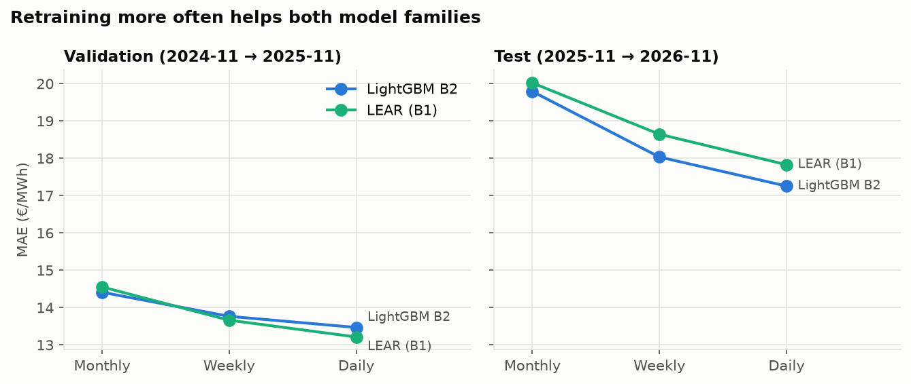
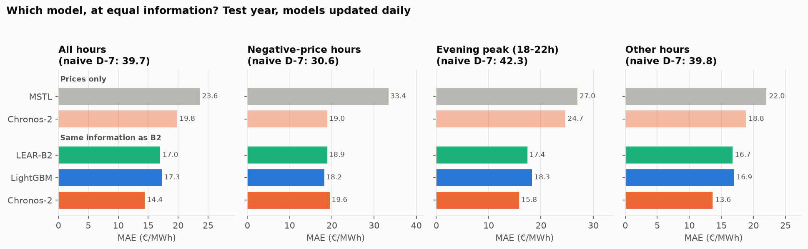
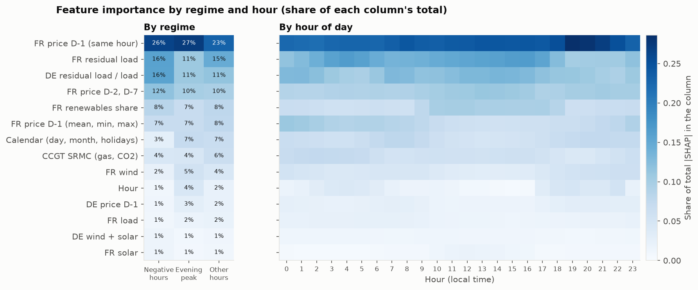

# French day-ahead power price forecasting

Hourly forecasts of the French day-ahead (SDAC) electricity price, built only from information
available before the auction closes at 12:00 on D-1. The project measures **what each block of market
information is worth** (calendar → price history → fundamentals → fuels and neighbours), tests the
differences statistically, and compares a gradient-boosting model with the literature's linear
reference (LEAR) and a zero-shot time-series foundation model (Chronos-2).

**Headline results (test year, Nov. 2025 – Oct. 2026, run once):**

- The main model (LightGBM with fundamentals, gas and CO₂ costs and German data, retrained daily)
  reaches an MAE of **17.3 €/MWh**, i.e. **44 %** of the naive "same hour last week" error.
- **Against the literature's linear benchmark (LEAR), the information matters more than the model:**
  given the same inputs and the same daily retraining, LightGBM beats LEAR by only **0.9 €/MWh**
  (Diebold-Mariano p = 0.02), while giving LEAR the gas, CO₂ and German data improves it by
  **1.6 to 2.3 €/MWh**.
- **Retraining frequency matters more than the model choice:** retraining LightGBM daily instead of
  monthly cuts its error by 2.5 €/MWh.
- **A zero-shot foundation model given the same fundamentals does better still** (Chronos-2:
  14.4 €/MWh, p < 0.001), except on negative-price hours, where the two are level.
- **Post-test extension:** borrowing Chronos-2's ingredients brings LightGBM down to **15.6 €/MWh**
  (daily retraining). Those ingredients are recent-error correction, recency weights, and day-shape and
  regime features. That closes more than half of the gap, but Chronos-2 stays significantly ahead
  (p = 0.006), and a post-hoc hyperparameter search does not change that.

---

## Contents

1. [Questions](#questions)
2. [Data and information set](#data-and-information-set)
3. [Method](#method)
4. [Results](#results)
5. [Post-test extension: borrowing from Chronos-2](#post-test-extension-borrowing-from-chronos-2)
6. [Post-hoc hyperparameter tuning](#post-hoc-hyperparameter-tuning)
7. [What drives the forecasts](#what-drives-the-forecasts)
8. [Market takeaways](#market-takeaways)
9. [Limitations](#limitations)
10. [Reproducing the results](#reproducing-the-results)
11. [Acknowledgements](#acknowledgements)

---

## Questions

| Hypothesis (set before modelling) | Verdict |
|---|---|
| Fundamentals, above all residual load, bring most of the gain beyond price lags, especially on negative-price hours and peaks. | **Partly confirmed.** French fundamentals cut the error by 18 % (validation) to 20 % (test), and slightly more at the evening peak (19 to 22 %). On negative-price hours the gain is 27 % on validation but only 13 % on the test. |
| At a one-day horizon, gas and CO₂ add little in a stable regime but matter as a *scale* when prices change regime, hence normalising the target by the gas-plant cost (SRMC). | **Confirmed.** Gas, CO₂ and German data add about 1 €/MWh in calm years. Normalising the target changes nothing then (validation p = 0.73, test p = 0.09) but cuts the error by 17 % in the 2021–2022 gas crisis (p < 0.001). |
| A "universal" model that only sees past prices (MSTL, Chronos) stays below the model with fundamentals. | **True for price-only models** (test MAE: MSTL 23.6 and Chronos-2 19.8 €/MWh, against 17.3), **false once the foundation model gets the fundamentals** (14.4). |

## Data and information set

**Golden rule:** every input for delivery day D must be published before the SDAC auction closes at
**12:00 (Paris time) on D-1**. No realised data (actual generation, physical flows) is ever used.

| Data | Source | Known at decision time |
|---|---|---|
| French day-ahead price (target and lags) | ENTSO-E Transparency (`entsoe-py`) | up to D-1 |
| German-Luxembourg day-ahead price | ENTSO-E | up to D-1 |
| Load forecast D-1, France and Germany | ENTSO-E | before 10:00 on D-1 |
| Wind and solar forecast D-1, France and Germany | ENTSO-E | assumed before 12:00 on D-1 (see [limitations](#limitations)) |
| TTF gas, front month | Yahoo Finance (`TTF=F`) | last close dated ≤ D-2 |
| EUA carbon, December contract | Investing.com (manual CSV, not redistributed) | last close dated ≤ D-2 |

- **Period:** 1 Oct. 2018 (creation of the DE-LU bidding zone) to 20 Nov. 2026, 71,353 hours.
- **Resolution:** hourly averages, because the European day-ahead market moved to 15-minute products on 1 Oct. 2025.
- **Data is not versioned.** The scripts rebuild it from the APIs (see [reproducing](#reproducing-the-results)).

**Leakage control:** a register declares when each raw input is published and which inputs each
feature uses. `tests/test_no_leakage.py` checks the declarations and runs a "time-travel" test. It
erases everything published after the auction closes and checks that the features for day D do not
change, around tricky days (clock changes, Easter). A deliberately planted leak makes it fail. The
same kind of test covers the walk-forward split (no model is trained on the hours it forecasts), the
inputs of LEAR, MSTL and Chronos-2, and the error correction.

## Method

**Features (`src/features.py`).**
- Calendar: hour, weekday, month, French holidays, bridge days, clock changes.
- Price lags: same local hour on D-1, D-2 and D-7; mean, min and max of D-1.
- French fundamentals: load, wind and solar forecasts, residual load (load − wind − solar), renewables share.
- Fuels and neighbours:
  - CCGT short-run marginal cost: SRMC = TTF / 0.55 + EUA × 0.37 + 2 €/MWh.
  - German price D-1 (same hour and daily mean); German load, wind + solar and residual-load forecasts.

**Main model: LightGBM** (gradient-boosted decision trees). One model covers the 24 hours (the hour
is a feature). It is trained on the absolute error, the loss that matches the MAE. Its
hyperparameters were fixed before the first run and never changed: 800 trees, learning rate 0.03,
63 leaves, at least 50 rows per leaf, 80 % of the rows and of the features sampled for each tree.
A search run at the very end produced separate, tuned variants
([post-hoc tuning](#post-hoc-hyperparameter-tuning)).

**Ablation: information added step by step, everything else fixed.**

| Step | Adds |
|---|---|
| A1 | calendar |
| A2 | + price lags |
| B1 | + French fundamentals |
| B2 | + gas, CO₂ (via the SRMC) and Germany; target = price − SRMC |

**Benchmarks (`src/benchmarks.py`).**
- **Naive forecasts** D-1 and D-7. D-7 is the reference for the relative MAE (rMAE).
- **MSTL** (Bandara, Hyndman and Bergmeir, 2021): the classical statistical baseline. It splits the last 8 weeks of prices into a trend, a daily cycle and a weekly cycle, and extends each of them. Prices only, refitted every day.
- **LEAR** (Lago et al., 2021, *Applied Energy* 293), the standard linear benchmark of the price-forecasting literature: one LASSO regression per hour, averaged over 56, 84, 1,092 and 1,456-day windows, re-estimated monthly, weekly or daily. Standard LEAR uses the same data as B1: French prices, load and renewables forecasts, and the weekday.
  - As in the paper, its forecasts are not clipped. LEAR works on an asinh scale, and converting back with sinh occasionally explodes: on the test year, daily LEAR forecast up to 2,090 €/MWh, when the actual price never exceeded 391. LEAR comparisons are therefore also run without the hours where a forecast exceeds, in absolute value, every price of the previous 365 days (`results/diebold_mariano_*_plausible.csv`).
- **LEAR-B2:** the same model with B2's information added (German price D-1, German load and renewables forecasts, SRMC), re-estimated daily. It isolates the model effect from the information effect. It never explodes on the test year.
- **Chronos-2** (Amazon, Oct. 2025): a time-series foundation model, pre-trained on a large collection of series from many domains and used here without any training on French prices ("zero-shot"). At each forecast it reads the last 12 weeks of prices, with or without the same fundamentals as B2.

**Protocol (`src/backtest.py`).**
- **Walk-forward with an expanding window:** the model is retrained on the 1st of each month, every 7 days or every day, on every delivery before that date, and forecasts until the next retraining.
- **Validation** (Nov. 2024 – Oct. 2025) for every modelling choice; **test** (Nov. 2025 – Oct. 2026) run once at the end; plus a **crisis** robustness period (Jul. 2021 – Dec. 2022).
- **Metrics:** MAE and rMAE, overall and by regime: negative-price hours (actual price below zero), evening peak (18:00–22:00), other hours. No MAPE, since prices cross zero.
- **Significance:** Diebold-Mariano test on daily-averaged absolute-error differences, with Newey-West (HAC) variance (5 lags) and two-sided p-values. The comparison pairs were written down before the runs they test, except where flagged (`DM_PAIRS` in `src/backtest.py`). Tests within a single regime are exploratory.

## Results

Each result below answers one question and varies **one thing at a time**: the information, the
retraining pace, the model or the target. Full tables (every model, every period, every
Diebold-Mariano test, also by regime and without LEAR's exploding hours) are in [`results/`](results/).

**Summary (MAE in €/MWh; rMAE vs naive D-7 in brackets):**

| Model | Information | Updated | Validation | Test | Test, negative hours | Test, evening peak |
|---|---|---|---|---|---|---|
| Naive D-7 | last week's price | – | 32.4 | 39.7 | 30.6 | 42.3 |
| LEAR | B1 (no gas, no Germany) | daily | 15.0 | 20.5 (0.52) | 24.7 | 19.4 |
| LEAR-B2 | B2 | daily | 14.2 | 18.2 (0.46) | 22.1 | 18.1 |
| **LightGBM B2 (main model)** | B2 | daily | 13.5 | 17.3 (0.44) | **18.2** | 18.3 |
| LightGBM final (post-test extension) | B3 + error correction | daily | **12.4** | 15.6 (0.39) | 22.9 | **15.7** |
| **Chronos-2 + fundamentals** | B2 | daily, no training | not run | **14.4 (0.36)** | 19.6 | 15.8 |

Chronos-2 was released on 17 Oct. 2025, after the validation year had started, so it may have seen
those prices during pre-training. It was therefore run on the test year only, which it cannot have seen.

### 1. What each block of information is worth


Same model (LightGBM), same weekly retraining; one block of information added at each step.

- **Price lags** do most of the work: calendar effects alone are worse than the naive forecast.
- **French fundamentals** cut the error by a further 18 % (validation) to 20 % (test), p < 0.001 on both. On negative-price hours the gain is 27 % on validation but only 13 % on the test: less stable than the overall gain.
- **Gas, CO₂ and Germany** add a smaller but significant 1.35 (validation, p < 0.001) and 0.95 €/MWh (test, p = 0.03). The gain per hour is largest at the evening peak (−2.4 and −1.9 €/MWh), when gas plants set the price.

**The extra information helps every model** (test year; negative gap = the version with more information has the lower error):

| Model | Information added | MAE gap (€/MWh) | p-value |
|---|---|---|---|
| LightGBM (weekly) | B1 → B2: gas, CO₂, Germany | −0.95 | 0.03 |
| LEAR (daily) | B1 → B2: gas, CO₂, Germany | −2.30 (−1.59 without LEAR's exploding hours) | < 0.001 |
| Chronos-2 | prices only → fundamentals of B2 | −5.41 | < 0.001 |

### 2. How often to retrain



Same information (B2 for LightGBM, B1 for LEAR); only the retraining pace changes.

- **Updating often helps both model families, with diminishing returns.** For LightGBM, weekly instead of monthly is worth 1.76 €/MWh on the test and daily instead of weekly another 0.78 (both p < 0.001).
- **LEAR needs fresh estimates at least as much.** Re-estimating it daily rather than monthly is worth 2.7 €/MWh on validation (p < 0.001). On the test year, monthly LEAR explodes on 19 hours (up to 32,721 €/MWh in July 2026), which inflates its MAE in the figure (28.9). Without those hours the gain from daily re-estimation is again 2.7 €/MWh (p < 0.001).

### 3. Which model, at equal information



Models are only compared with the same inputs, in two groups: prices only (MSTL, a classical seasonal
decomposition, against Chronos-2, a pre-trained foundation model), then the full information of B2
(LEAR-B2, the literature's linear benchmark given B2's inputs, against LightGBM and Chronos-2).
Every model is updated daily; MSTL and Chronos-2 re-read the latest prices at each forecast.

**Diebold-Mariano tests, test year** (negative gap = the first model has the lower error):

| Comparison | Information | MAE gap (€/MWh) | p-value |
|---|---|---|---|
| Chronos-2 vs MSTL (added after the test run) | prices only | −3.80 | < 0.001 |
| LightGBM vs LEAR-B2 | B2 | −0.90 | 0.02 |
| LightGBM vs Chronos-2 (chosen after seeing the results) | B2 | +2.87 | < 0.001 |

- **With prices only,** the foundation model clearly beats the classical decomposition; the gap is widest on negative-price hours (19.0 vs 33.4 €/MWh).
- **With the same information, LightGBM beats LEAR by only 0.9 €/MWh.** The gap per hour is widest on negative-price hours (18.2 vs 22.1 €/MWh, p = 0.04), but ordinary hours, twelve times more numerous, carry three quarters of it (16.9 vs 17.8). The two are level at the evening peak. The information matters more than the model (see section 1).
- **Chronos-2 with fundamentals is the best model overall** (14.4) and at the evening peak. On negative-price hours, LightGBM's 18.2 against 19.6 €/MWh is a statistical tie (p = 0.85). The comparison fixed before the test run, with weekly LightGBM, gives the same verdict (+3.64 €/MWh, p < 0.001).

### 4. Normalising the target by the gas-plant cost


Same model, same information (B2); only the target changes: raw price, price − SRMC, or price − w(RL) × SRMC,
where w is the pass-through of gas cost to the French price by residual-load decile (0.7 to 1.5).

- **Crisis (Jul. 2021 – Dec. 2022):** predicting price − SRMC cuts the error from 38.0 to 31.4 €/MWh (p < 0.001). The largest gain came when gas peaked: 16 €/MWh in Q3 2022, when TTF averaged 200 €/MWh.
- **Calm years:** no difference (monthly retraining: validation p = 0.73, test p = 0.09).
- **Negative-price hours are the exception:** on the test year the raw-price target does better there (17.4 vs 18.8 €/MWh, weekly retraining); the two are level on validation. When the price is negative, gas is not setting it, so subtracting the gas cost adds noise.
- **Weighting by residual load** adds nothing on any period (p = 0.17 to 0.74): LightGBM already learns that interaction.

### 5. One test week


The models track the daily profile closely. Chronos-2 is closest on most days but overshoots the
midday dip on Friday 8 May, forecasting −50 €/MWh against an actual price of about 0, while LightGBM
stays at 16–27 €/MWh. That illustrates why Chronos-2's edge disappears on negative-price hours.

## Post-test extension: borrowing from Chronos-2

After seeing Chronos-2 win on the test year, we tried to give LightGBM the ingredients that probably
explain its edge. Each idea was developed and **chosen on the validation year only**, then run once on
the test year with comparisons fixed in advance. Because the idea itself came from a test result,
this section is reported separately from the main results.

| Chronos-2 behaviour | LightGBM counterpart |
|---|---|
| Re-learns from the last weeks at every forecast | **Recency weights:** a training row's weight halves every 90 days (half-life chosen among 90, 180 and 365 days on validation). |
| Corrects itself quickly | **Recent-error correction:** a second-stage median regression predicts today's error from yesterday's error and the last 7 days' errors. Yesterday's error is known at 12:00 on D-1, since D-1 prices are published on D-2. Tested for leakage. |
| Sees the whole day and the current regime | **Step B3 = B2 +** the shape of day D (residual-load minimum, maximum, mean and trough hour; each hour's position in the day; solar peak) **+** regime features (price − SRMC gap, volatility and negative-hour share over 14 days; price sensitivity to residual load over 28 days). |


- **Error correction is the robust idea:** −1.16 €/MWh on the main model (p < 0.001), with negative-price hours unchanged.
- **Day-shape and regime features help** a little more on the test (B3 vs B2, weekly retraining: −0.69 €/MWh, p = 0.003). On validation they only helped combined with recency weights and the error correction (−0.39, p < 0.001).
- **Recency weights backfired on negative-price hours** (22.9 against 17.6 €/MWh without them). A 90-day half-life makes the model forget earlier springs, which is precisely when negative prices happen. On validation they cost only 0.5 €/MWh on those hours, too little to stand out.
- **The final model beats the main model by 1.7 €/MWh** (p < 0.001), but **Chronos-2 stays ahead by 1.2 €/MWh** (p = 0.006).

**Choosing the final version.** Daily retraining was too slow to run for every variant (hours of
computing per year of backtest), so only the two best weekly versions were rerun daily. The rule was
written down before the runs: keep the daily version with the lowest validation MAE on Feb.–Oct. 2025
(the error correction needs a 90-day history first, so it only starts in February; the summary table
shows the full year) and report its test figure, whatever it is. Recency weights won on validation
(12.33 against 13.15), so they are in the final model, even though the version without them did
better on the test (15.87, and 17.6 on negative-price hours).

**The lesson:** adapting fast to recent data helps ordinary hours but is risky for rare, seasonal
events. A foundation model that has seen many regimes handles that trade-off better than a
single-market model.

## Post-hoc hyperparameter tuning

All results above use the fixed LightGBM setting given in [Method](#method). As a last check, a random
search looked for a better one **on the validation year only**: 85 settings (as many as fitted in one
night) of tree count, learning rate, leaves, minimum leaf size, row and column subsampling and L2
penalty, scored on B2 with weekly retraining. Setting 0 is the default and reproduces its validation
MAE (13.77), a sanity check. The best setting (3,000 trees, learning rate 0.01, 115 leaves) was then
applied unchanged to the main and the final model, retrained daily, and run once on the test year.
The comparisons were fixed before the search. The existing models keep the default setting; the
tuned ones are separate models. Their validation figures are flattering, since the setting was chosen
on that year; the test figures are not.

| Model (daily retraining) | Validation, default → tuned | Test, default → tuned | Test gap (p-value) |
|---|---|---|---|
| Main model (B2) | 13.47 → 13.32 | 17.26 → **16.94** | −0.32 (p < 0.001) |
| Final model (B3 + recency weights + correction) | 12.39 → 12.34 | 15.58 → 15.62 | +0.04 (p = 0.68) |

- **The default was already near the top:** the search's best validation MAE was 13.73 against 13.77.
- **Tuning helps the simpler model** a little (−0.3 €/MWh on the test, significant), **but not the
  final one:** its extra features and error correction probably already capture what slower, finer
  trees add.
- The tuned final model trains about 6 times slower, so **the final model keeps the default setting.**
  Information, not hyperparameters, is the bottleneck: Chronos-2 stays 1.2 €/MWh ahead (p = 0.006).

## What drives the forecasts

The SHAP values below are for B2, trained on all data before the test and explained on the test hours
(`src/importance.py`). They explain the spread to the gas-plant cost (the model's target). The SRMC
level itself is added back afterwards.


- **Yesterday's price at the same hour** dominates (16 €/MWh of average contribution). Prices are persistent from one day to the next.
- **French and German residual load** come next, ahead of the raw load, wind and solar forecasts. The model reasons in "what is left for dispatchable plants to cover", across the coupled FR-DE zone. Solar alone looks minor because residual load and the renewables share already carry its effect.



- **Negative-price hours** are driven more by residual load (FR and DE: 16 % each, against 11 % at the evening peak). Calendar effects matter much less (3 % against 7 %). Prices collapse when renewables exceed demand, whatever the day.
- **Evening hours (19:00–21:00)** lean most on yesterday's price, because the evening peak is the most repetitive part of the day.
- **Midday hours** (10:00–17:00) give more weight to the renewables share (10 % of the total, against 6–7 % at night): the solar effect.

The merit-order picture behind these results:


## Market takeaways

1. **Fundamentals beat history.** French load and renewables forecasts cut the error by about a fifth on top of price lags. On negative-price hours the gain was a quarter on validation but only 13 % on the test year, so it is less stable than the overall gain.
2. **Gas increasingly fails to set the French price.** The average spread between price and CCGT cost went from +1 to +4 €/MWh (2019–2022) to −31 to −35 €/MWh (2024–2026), as nuclear recovered and solar grew. Normalising by gas cost protects against fuel shocks, but tells less and less about everyday prices, and on the test year it even hurt on negative-price hours, where gas plays no role.
3. **Model freshness is a first-order choice.** Retraining daily instead of monthly is worth 2.5 €/MWh on the test year and costs about 8 seconds a day in production.
4. **The information matters more than the model.** With the same information and daily retraining, LightGBM beats LEAR by 0.9 €/MWh on the test (p = 0.02) and 0.8 on validation (p = 0.07). Its edge per hour is largest on negative-price hours (18.2 vs 22.1 €/MWh), where non-linearity helps, and nil at the evening peak (18.3 vs 18.1). Gas, CO₂ and German data cut LEAR's error by more: 1.6 to 2.3 €/MWh.
5. **In-context foundation models are a serious contender.** Fed the same fundamentals, a zero-shot model, never trained on this market, beat a gradient-boosting model trained on seven years of French data by 17 %. It adapts to the latest weeks of data at every forecast, but it can overshoot extreme renewables hours.
6. **Correcting yesterday's bias is the cheapest win; forgetting the past is the riskiest.** A recent-error correction is worth 1.2 €/MWh. Down-weighting old data helps ordinary hours, but it erases the seasonal memory needed for negative prices.

## Limitations

- **Wind and solar forecasts:** EU rules only require D-1 forecasts by 18:00 on D-1. We assume they are available at 12:00, as is standard practice in the literature; ENTSO-E keeps only the latest version.
- **Gas and carbon proxies:** free data only.
  - TTF front month from Yahoo and the EUA December contract from Investing.com.
  - Contract rolls create small jumps: about 1 €/MWh on the SRMC for EUA; a few TTF rolls are visible, e.g. Sept. 2019.
  - Closes are taken at D-2, which is conservative: traders see intraday TTF on the morning of D-1.
- **Hourly averages** since the move to 15-minute products in Oct. 2025 smooth out part of the intra-hour shape.
- **No nuclear availability.** French nuclear outage notices (UMMs) were left out: the as-announced history is hard to rebuild reliably. They are the most promising missing input, especially in winter.
- **Chronos-2:**
  - Its training data is not published; contamination of the test is ruled out by its release date only.
  - It could not be checked on the validation year.
  - The B2 daily vs Chronos-2 comparison was not fixed in advance; the one that was, with weekly B2, gives the same verdict.
- **One test year.** The main results use fixed hyperparameters; tuning was tried afterwards, on validation only, and changed little (see [Post-hoc hyperparameter tuning](#post-hoc-hyperparameter-tuning)). The negative-hour statistics rest on 513 (validation) and 565 (test) hours.
- **Many tests.** About 40 pairs are tested per period, plus exploratory tests by regime: a single p-value near 0.05 is weak evidence on its own. The headline comparisons have p ≤ 0.02 on the test year and, where they were also run on validation, the same sign there.
- **LEAR-B2 and the weekly ablation steps A1 and A2 were added after the test year had been run**, in answer to a review: they isolate the model effect in the LEAR comparison and put the whole ablation at one retraining pace. Their design and comparisons were fixed before they were run, and no choice depends on them.
- **The post-test extension was motivated by a test result.** Each idea was developed and chosen on validation, but the test year has now been used more than once, so its test figures are less clean than the main results.
- The gas pass-through weights w(RL) are estimated before the validation year and **drift over time** (0.26 at low residual load in 2024 against 0.5–0.8 before).

## Reproducing the results

```bash
pip install -r requirements.txt          # on macOS with conda, install PyTorch from conda-forge
cp .env.example .env                     # add your ENTSO-E API key
# download the EUA December futures history (Investing.com) to data/raw/eua_investing.csv
python -m src.get_data                   # ENTSO-E, TTF and EUA -> data/processed/dataset_hourly.parquet
python -m pytest                         # leakage tests

# Backtests: each period runs its models of RUNS (src/backtest.py); daily retraining takes hours
python -m src.backtest --period crisis   # 2021-2022 gas crisis
python -m src.backtest --period burn_in  # error history for the corrections (Nov. 2023 - Oct. 2024)
python -m src.backtest                   # validation year
python -m src.backtest --period test     # test year, run once at the end

# Post-test extension: recent-error corrections (validation, then test)
for m in B2_weekly B2_weekly_hl90 B3_weekly B3_weekly_hl90; do
  python -m src.correction --base $m --period validation --history burn_in; done
for m in B3_daily B3_daily_hl90; do       # no daily burn-in run: the correction starts after 90 days
  python -m src.correction --base $m --period validation; done
for m in B2_daily B2_weekly_hl90 B3_weekly B3_weekly_hl90 B3_daily B3_daily_hl90; do
  python -m src.correction --base $m --period test --history validation; done

# Post-hoc tuning: overnight search (3 workers in parallel), then the tuned models
for w in 0 1 2; do python -m src.tuning search --worker $w --workers 3 --until 03:30 & done; wait
python -m src.tuning summary             # results/tuning_validation.csv
for p in validation test; do
  python -m src.tuning final --period $p --model B2_daily_tuned
  for c in 0 1 2; do python -m src.tuning final --period $p --model B3_daily_hl90_tuned --chunk $c & done; wait
  python -m src.tuning merge --period $p --model B3_daily_hl90_tuned; done
python -m src.correction --base B3_daily_hl90_tuned --period validation
python -m src.correction --base B3_daily_hl90_tuned --period test --history validation

for p in validation test; do python -m src.backtest --period $p --models; done   # tables only
python -m src.importance                 # SHAP importance
python -m src.figures                    # figures
```

```
src/
  get_data.py     download and build the hourly dataset
  features.py     features, ablation steps, publication register
  backtest.py     walk-forward, metrics, Diebold-Mariano
  benchmarks.py   MSTL, LEAR, Chronos-2
  correction.py   recent-error correction (second stage)
  tuning.py       hyperparameter random search (validation only)
  importance.py   SHAP feature importance
  figures.py      figures
tests/            leakage tests
results/          metrics, tests and figures (versioned)
```

## Acknowledgements

Code and analysis were developed with the help of Claude (Anthropic), used as an AI coding assistant.
Research design, data choices and interpretation of the results are my own.
