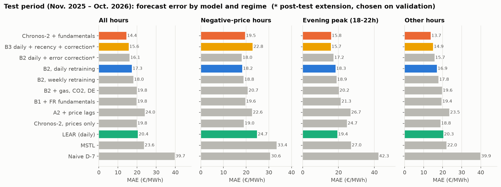
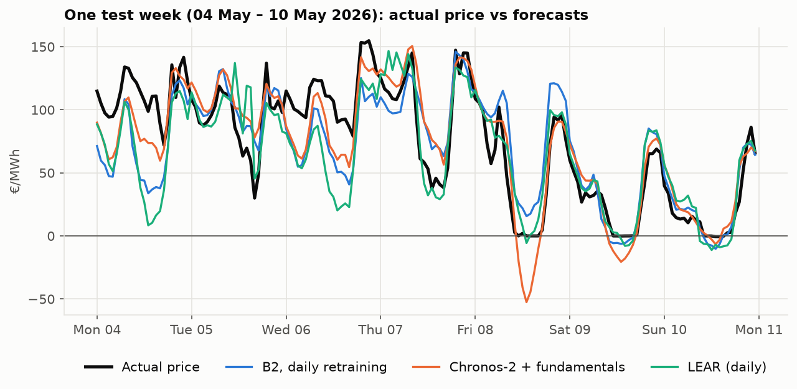

# French day-ahead power price forecasting

Hourly forecasts of the French day-ahead (SDAC) electricity price, built only from information
available before the auction closes at 12:00 on D-1. The project measures **what each block of market
information is worth** (calendar → price history → fundamentals → fuels and neighbours), tests the
differences statistically, and compares a gradient-boosting model with the literature's linear
reference (LEAR) and a zero-shot time-series foundation model (Chronos-2).

**Headline results (test year, Nov. 2025 – Oct. 2026, run once):**

- The main model (LightGBM with fundamentals, gas and CO₂ costs and German data, retrained daily)
  reaches an MAE of **17.3 €/MWh**, i.e. **44 %** of the naive "same hour last week" error, and beats
  LEAR by 3.2 €/MWh (Diebold-Mariano p < 0.001).
- **Retraining frequency matters as much as model choice:** daily instead of monthly retraining
  cuts the error by 2.5 €/MWh.
- **A zero-shot foundation model given the same fundamentals does better still** (Chronos-2:
  14.4 €/MWh, p < 0.001), except on negative-price hours, where the two are level.
- **Post-test extension:** borrowing Chronos-2's ingredients brings LightGBM down to **15.6 €/MWh**
  (daily retraining). Those ingredients are recent-error correction, recency weights, and day-shape and
  regime features. That closes most of the gap, but Chronos-2 stays significantly ahead (p = 0.007).



---

## Contents

1. [Questions](#questions)
2. [Data and information set](#data-and-information-set)
3. [Method](#method)
4. [Results](#results)
5. [Post-test extension: borrowing from Chronos-2](#post-test-extension-borrowing-from-chronos-2)
6. [What drives the forecasts](#what-drives-the-forecasts)
7. [Market takeaways](#market-takeaways)
8. [Limitations](#limitations)
9. [Reproducing the results](#reproducing-the-results)
10. [Acknowledgements](#acknowledgements)

---

## Questions

| Hypothesis (set before modelling) | Verdict |
|---|---|
| Fundamentals, above all residual load, bring most of the gain beyond price lags, especially on negative-price hours and peaks. | **Confirmed.** Adding French fundamentals cuts the error by 17 % (validation) to 18 % (test); on negative hours by 27 % on validation but only 13 % on the test. |
| At a one-day horizon, gas and CO₂ add little in a stable regime but matter as a *scale* when prices change regime, hence normalising the target by the gas-plant cost (SRMC). | **Confirmed.** Normalising changes nothing in calm years (p = 0.73) but cuts the error by 17 % in the 2021–2022 gas crisis (p < 0.001). |
| A "universal" model that only sees past prices (MSTL, Chronos) stays below the model with fundamentals. | **True for price-only models, false once the foundation model gets the fundamentals.** |

## Data and information set

**Golden rule:** every input for delivery day D must be published before the SDAC auction closes at
**12:00 (Paris time) on D-1**. No realised data (actual generation, physical flows) is ever used.

| Data | Source | Known at decision time |
|---|---|---|
| French day-ahead price (target and lags) | ENTSO-E Transparency (`entsoe-py`) | up to D-1 |
| German-Luxembourg day-ahead price | ENTSO-E | up to D-1 |
| Load forecast D-1, France and Germany | ENTSO-E | before 10:00 on D-1 |
| Wind and solar forecast D-1, France and Germany | ENTSO-E | assumed before 12:00 on D-1 (see [limitations](#limitations)) |
| TTF gas, front month | Yahoo Finance (`TTF=F`) | last close dated ≤ D-2 |
| EUA carbon, December contract | Investing.com (manual CSV, not redistributed) | last close dated ≤ D-2 |

- **Period:** 1 Oct. 2018 (creation of the DE-LU bidding zone) to 20 Nov. 2026, 71,353 hours.
- **Resolution:** hourly averages, because the European day-ahead market moved to 15-minute products on 1 Oct. 2025.
- **Data is not versioned.** The scripts rebuild it from the APIs (see [reproducing](#reproducing-the-results)).

**Leakage control:** a register declares when each raw input is published and which inputs each
feature uses. `tests/test_no_leakage.py` checks the declarations and runs a "time-travel" test. It
erases everything published after the auction closes and checks that the features for day D do not
change, around tricky days (clock changes, Easter). A deliberately planted leak makes it fail.

## Method

**Features (`src/features.py`).**
- Calendar: hour, weekday, month, French holidays, bridge days, clock changes.
- Price lags: same local hour on D-1, D-2 and D-7; mean, min and max of D-1.
- French fundamentals: load, wind and solar forecasts, residual load (load − wind − solar), renewables share.
- Fuels and neighbours:
  - CCGT short-run marginal cost: SRMC = TTF / 0.55 + EUA × 0.37 + 2 €/MWh.
  - German price D-1, German residual load.

**Ablation: one main model (LightGBM, fixed hyperparameters), information added step by step.**

| Step | Adds |
|---|---|
| A1 | calendar |
| A2 | + price lags |
| B1 | + French fundamentals |
| B2 | + gas, CO₂ (via the SRMC) and Germany; target = price − SRMC |

**Benchmarks (`src/benchmarks.py`).**
- **Naive forecasts** D-1 and D-7. D-7 is the reference for the relative MAE (rMAE).
- **MSTL:** daily and weekly seasonal decomposition of prices only.
- **LEAR** (Lago et al., 2021, *Applied Energy* 293): one LASSO regression per hour, averaged over 56, 84, 1,092 and 1,456-day windows, re-estimated monthly, weekly or daily.
- **Chronos-2** (Amazon, Oct. 2025): zero-shot, with prices only or with the same fundamentals as B2.

**Protocol (`src/backtest.py`).**
- **Walk-forward with an expanding window:** each retraining uses every delivery before the retraining date.
- **Validation** (Nov. 2024 – Oct. 2025) for every modelling choice; **test** (Nov. 2025 – Oct. 2026) run once at the end; plus a **crisis** robustness period (Jul. 2021 – Dec. 2022).
- **Metrics:** MAE and rMAE, overall and by regime: negative-price hours, evening peak (18:00–22:00), other hours. No MAPE, since prices cross zero.
- **Significance:** Diebold-Mariano test on daily-averaged absolute-error differences, with Newey-West (HAC) variance and comparison pairs fixed in advance.

## Results

**Error by model (MAE in €/MWh; rMAE in brackets):**

| Model | Validation | Test | Test, negative hours | Test, evening peak |
|---|---|---|---|---|
| Naive D-7 | 32.4 (1.00) | 39.7 (1.00) | 30.6 | 42.3 |
| MSTL (prices only) | 19.0 (0.59) | 23.6 (0.59) | 33.4 | 27.0 |
| LEAR, daily | 15.0 (0.46) | 20.5 (0.52) | 24.7 | 19.4 |
| Chronos-2, prices only | (not run, see note) | 19.8 (0.50) | 19.0 | 24.7 |
| A2: + price lags | 18.5 (0.57) | 24.0 (0.60) | 22.6 | 26.7 |
| B1: + French fundamentals | 15.5 (0.48) | 19.8 (0.50) | 19.6 | 21.3 |
| B2: + gas, CO₂, Germany | 14.4 (0.44) | 19.8 (0.50) | 20.7 | 20.2 |
| B2, weekly retraining | 13.8 (0.42) | 18.0 (0.45) | 18.8 | 18.9 |
| **B2, daily retraining (main model)** | **13.5 (0.42)** | **17.3 (0.44)** | **18.2** | 18.3 |
| **Chronos-2 + fundamentals** | (not run, see note) | **14.4 (0.36)** | 19.6 | **15.8** |

Steps A1 to B2 are retrained monthly. Full tables are in [`results/`](results/) and in [`report.pdf`](report.pdf).

Chronos-2 was released on 17 Oct. 2025, after the validation year had started, so it may have seen
those prices during pre-training. It was therefore run on the test year only, which it cannot have seen.

**Selected Diebold-Mariano tests, test year** (negative gap = first model better):

| Comparison | MAE gap (€/MWh) | p-value |
|---|---|---|
| B2 daily vs LEAR daily | −3.20 | < 0.001 |
| B2 daily vs B2 weekly | −0.78 | < 0.001 |
| B2 weekly vs B2 monthly | −1.76 | < 0.001 |
| B1 weekly vs LEAR weekly (same information, same cadence) | −1.95 | 0.01 |
| B2 daily vs Chronos-2 + fundamentals (chosen after seeing the results) | +2.84 | < 0.001 |
| B2 (price − SRMC target) vs raw-price target | +0.47 | 0.09 |

**Retraining frequency.** Updating the model often helps both families, with diminishing returns.
LEAR, whose short windows go stale, collapses when re-estimated only monthly.


**Normalising by the gas-plant cost is insurance, not a free lunch.**
- **Crisis (Jul. 2021 – Dec. 2022):** predicting price − SRMC instead of the raw price cuts B2's error from 38.0 to 31.4 €/MWh (p < 0.001). The gain grows with the gas price, reaching 16 €/MWh in Q3 2022.
- **Calm years:** it makes no difference (validation p = 0.73; test +0.47, p = 0.09).
- **Negative-price hours are the exception:** on the test year, the raw-price target does better than the normalised one on negative hours (17.7 vs 20.7 €/MWh with monthly retraining, 17.4 vs 18.8 with weekly retraining); the two are level on validation. When the price is negative, gas is not setting it, so subtracting the gas cost adds noise rather than removing it.
- **Weighting by residual load:** the pass-through of gas cost to the French price varies with residual load, from 0.7 to 1.2. Weighting the normalisation by it adds nothing on any period (p = 0.61 to 0.74): LightGBM already learns that interaction.

**A test week.** The models track the daily profile closely. Chronos-2 is closest on most days but
overshoots the midday dip on Friday 8 May, forecasting −50 €/MWh against an actual price of about 0.
That illustrates why its edge disappears on negative-price hours.



## Post-test extension: borrowing from Chronos-2

After seeing Chronos-2 win on the test year, we tried to give LightGBM the ingredients that probably
explain its edge.

**How this was done:**
- Each idea was developed and **chosen on the validation year only**, then run once on the test year.
- The comparisons were fixed in advance.
- Because the idea itself came from a test result, this section is reported separately from the main results.

**The three ideas:**

| Chronos-2 behaviour | LightGBM counterpart |
|---|---|
| Re-learns from the last weeks at every forecast | **Recency weights:** a training row's weight halves every 90 days (half-life chosen among 90, 180 and 365 days on validation). |
| Corrects itself quickly | **Recent-error correction:** a second-stage median regression predicts today's error from yesterday's error and the last 7 days' errors. Yesterday's error is known at 12:00 on D-1, since D-1 prices are published on D-2. Tested for leakage. |
| Sees the whole day and the current regime | **Step B3 = B2 +** the shape of day D (residual-load minimum, maximum, mean and trough hour; each hour's position in the day; solar peak) **+** regime features (price − SRMC gap, volatility and negative-hour share over 14 days; price sensitivity to residual load over 28 days). |

**Results (MAE in €/MWh):**

| Model | Retraining | Validation* | Test | Test, negative hours |
|---|---|---|---|---|
| B2 (main model) | daily | 13.41 | 17.26 | 18.2 |
| B2 + error correction | daily | n/a | 16.10 | 18.0 |
| B3 + error correction | weekly | 13.28 | 16.05 | 18.2 |
| B3 + recency weights + error correction | weekly | 12.46 | 15.92 | 22.7 |
| B3 + error correction | daily | 13.15 | 15.87 | **17.6** |
| **B3 + recency weights + error correction** (final, chosen on validation) | daily | **12.33** | **15.58** | 22.9 |
| Chronos-2 + fundamentals | none (zero-shot) | n/a | **14.42** | 19.6 |

\* Feb.–Oct. 2025. The error correction needs a 90-day history, and the daily models only have the validation year behind them, so the first three months are left out of the comparison.

**Choosing the final version.** Daily retraining was too slow to run for every variant (about 2.5 hours per year of backtest), so only the two best weekly versions were rerun daily. The rule was written down before the runs: keep the daily version with the lowest validation MAE on Feb.–Oct. 2025 and report its test figure, whatever it is. Recency weights won on validation (12.33 against 13.15).

**What held up on the test year:**
- **Error correction is the robust idea.** It cuts B2 daily's error by 1.16 €/MWh (p < 0.001) without hurting negative-price hours.
- **Day-shape and regime features help:** B3 beats B2 by 0.69 €/MWh at the same retraining pace (p = 0.003), mostly at the evening peak.
- **Daily retraining still pays** on top of all this: 15.58 against 15.92 with weekly retraining.
- **The final extension model beats the main model by 1.7 €/MWh** (p < 0.001).

**What did not hold up:**
- **Recency weights backfired on negative-price hours** (22.9 against 17.6 €/MWh without them). A 90-day half-life makes the model forget earlier springs, which is precisely when negative prices happen. They looked harmless on validation. Without recency weights, the daily model is the best LightGBM on negative hours and beats Chronos-2 there.
- **Chronos-2 stays ahead by 1.2 €/MWh** (p = 0.007).

**The lesson:** adapting fast to recent data helps ordinary hours but is risky for rare, seasonal events. A foundation model that has seen many regimes handles that trade-off better than a single-market model.

## What drives the forecasts

The SHAP values below are for B2, trained on all data before the test and explained on the test hours
(`src/importance.py`). They explain the spread to the gas-plant cost (the model's target). The SRMC
level itself is added back afterwards.


- **Yesterday's price at the same hour** dominates (16 €/MWh of average contribution). Prices are persistent from one day to the next.
- **French and German residual load** come next, ahead of the raw load, wind and solar forecasts. The model reasons in "what is left for dispatchable plants to cover", across the coupled FR-DE zone. Solar alone looks minor because residual load and the renewables share already carry its effect.


- **Negative-price hours** are driven more by residual load (FR and DE: 16 % each, against 11 % at the evening peak). Calendar effects matter much less (3 % against 7 %). Prices collapse when renewables exceed demand, whatever the day.
- **Evening hours (19:00–21:00)** lean most on yesterday's price, because the evening peak is the most repetitive part of the day.
- **Midday hours** (10:00–17:00) give more weight to the renewables share and residual load, which is the solar effect.

The merit-order picture behind these results:


## Market takeaways

1. **Fundamentals beat history, especially when prices go negative.** Residual load forecasts cut the error by about a fifth on top of price lags. On negative-price hours the gain was a quarter on validation but only 13 % on the test year, so it is less stable than the overall gain.
2. **Gas increasingly fails to set the French price.** The average spread between price and CCGT cost went from +1–6 €/MWh (2018–2022) to −35 €/MWh (2024–2026), as nuclear recovered and solar grew. Normalising by gas cost protects against fuel shocks, but tells less and less about everyday prices, and on the test year it even hurt on negative-price hours, where gas plays no role.
3. **Model freshness is a first-order choice.** Retraining daily instead of monthly is worth 2.5 €/MWh on the test year and costs about 8 seconds a day in production.
4. **Linear models are competitive in normal hours; non-linearity earns its keep around renewables thresholds.** With the same information and cadence, LightGBM beats LEAR on the test (p = 0.01). Its edge is largest on negative-price hours (19.6 vs 24.7 €/MWh), while LEAR is as good or better at the evening peak.
5. **In-context foundation models are a serious contender.** Fed the same fundamentals, a zero-shot model, never trained on this market, beat a gradient-boosting model trained on seven years of French data by 16 %. It adapts to the latest weeks of data at every forecast, but it can overshoot extreme renewables hours.
6. **Correcting yesterday's bias is the cheapest win; forgetting the past is the riskiest.** A recent-error correction is worth 1.2 €/MWh. Down-weighting old data helps ordinary hours, but it erases the seasonal memory needed for negative prices.

## Limitations

- **Wind and solar forecasts:** EU rules only require D-1 forecasts by 18:00 on D-1. We assume they are available at 12:00, as is standard practice in the literature; ENTSO-E keeps only the latest version.
- **Gas and carbon proxies:** free data only.
  - TTF front month from Yahoo and the EUA December contract from Investing.com.
  - Contract rolls create small jumps: about 1 €/MWh on the SRMC for EUA; a few TTF rolls are visible, e.g. Sept. 2019.
  - Closes are taken at D-2, which is conservative: traders see intraday TTF on the morning of D-1.
- **Hourly averages** since the move to 15-minute products in Oct. 2025 smooth out part of the intra-hour shape.
- **No nuclear availability.** French nuclear outage notices (UMMs) were left out: the as-announced history is hard to rebuild reliably. They are the most promising missing input, especially in winter.
- **Chronos-2:**
  - Its training data is not published; contamination of the test is ruled out by its release date only.
  - It could not be checked on the validation year.
  - The B2 daily vs Chronos-2 comparison was not fixed in advance.
- **One test year and fixed hyperparameters.** No tuning was done. The negative-hour statistics rest on 513 (validation) and 565 (test) hours.
- **The post-test extension was motivated by a test result.** Each idea was developed and chosen on validation, but the test year has now been used more than once, so its test figures are less clean than the main results.
- The gas pass-through weights w(RL) are estimated before the validation year and **drift over time** (0.26 at low residual load in 2024 against 0.5–0.8 before).

## Reproducing the results

```bash
pip install -r requirements.txt          # on macOS with conda, install PyTorch from conda-forge
cp .env.example .env                     # add your ENTSO-E API key
# download the EUA December futures history (Investing.com) to data/raw/eua_investing.csv
python -m src.get_data                   # ENTSO-E, TTF and EUA -> data/processed/dataset_hourly.parquet
python -m pytest                         # leakage tests
python -m src.backtest                   # validation year
python -m src.backtest --period crisis   # 2021-2022 gas crisis
python -m src.backtest --period test     # test year, run once (about 3 to 4 hours on a laptop CPU)
python -m src.backtest --period burn_in --models B3_weekly_hl90   # error history before validation
python -m src.correction --base B3_weekly_hl90 --period validation --history burn_in
python -m src.backtest --period test --models B3_daily_hl90   # final model, retrained daily
python -m src.correction --base B3_daily_hl90 --period test --history validation
python -m src.importance                 # SHAP importance
python -m src.figures                    # figures
python -m src.report                     # report.pdf
```

```
src/
  get_data.py     download and build the hourly dataset
  features.py     features, ablation steps, publication register
  backtest.py     walk-forward, metrics, Diebold-Mariano
  benchmarks.py   MSTL, LEAR, Chronos-2
  correction.py   recent-error correction (second stage)
  importance.py   SHAP feature importance
  figures.py      figures
  report.py       PDF report
tests/            leakage tests
results/          metrics, tests and figures (versioned)
```

## Acknowledgements

Code and analysis were developed with the help of Claude (Anthropic), used as an AI coding assistant.
Research design, data choices and interpretation of the results are my own.
